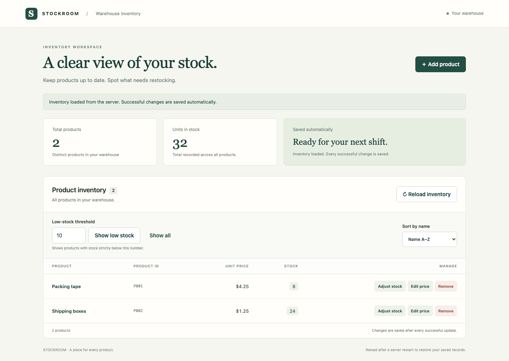
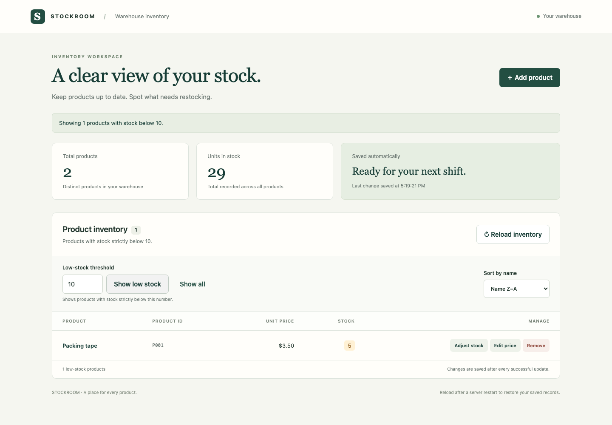
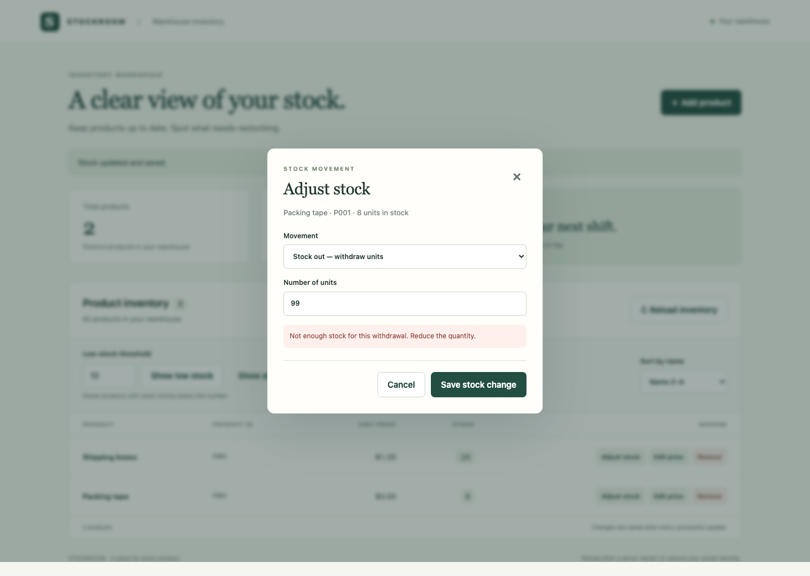
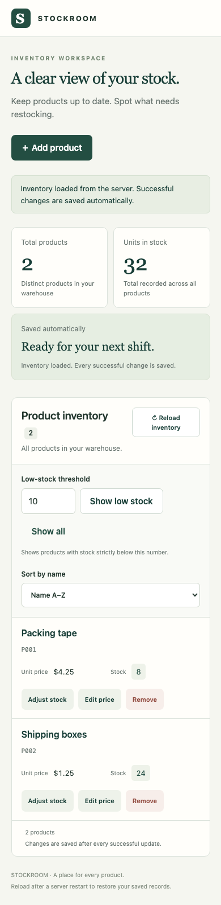

# Stockroom — Warehouse Inventory Management

A TypeScript application for small-warehouse staff to maintain product records, inspect inventory, identify replenishment needs, and record stock and price changes. Each product has a unique ID, name, unit price, and stock quantity. Phase 3 extends the Phase 2 model and REST backend with a browser frontend.

The browser frontend and REST API share one server. All eight stories below are implemented; successful changes save automatically, and startup restores the saved inventory. This repository is a tutor's teaching example. Students should select their own domain and understand their own implementation.

## Project Preview

### Inventory at a glance

View products, sort by name, and manage stock and prices from one workspace. Accepted changes are saved automatically and restored after a server restart.



### Find products that need restocking

Filter by a stock threshold and see the matching products and count.



### Clear feedback when a change is refused

Receive or withdraw stock, update unit prices, and confirm product removal. Invalid changes show a readable message and preserve the recorded inventory.



<details>
<summary>Mobile layout</summary>

Product cards keep stock, prices, and management actions accessible on smaller screens.



</details>

## Run the Application

Use Node.js 22 or later and pnpm. Run these commands **from the repository root** (the directory containing `package.json`):

```sh
pnpm install --frozen-lockfile
pnpm start
```

Open **http://localhost:3000/**, including the trailing slash. `pnpm start` type-checks the project, bundles browser TypeScript into `public/app.js`, watches it for changes, and starts the page and API. Reload the page after editing frontend code. Server code changes require a restart.

```sh
pnpm build
pnpm test
pnpm test:cover
```

`PORT` overrides port 3000. `INVENTORY_FILE` overrides the default `data/inventory.json`. Relative file paths use the working directory. `pnpm-workspace.yaml` permits the esbuild installation script; `esbuild` and `jsdom` are development tools with TypeScript support, not application features.

The page starts empty if there is no save file. Add a product using **Add product**, then use its **Adjust stock**, **Edit price**, or **Remove** buttons. Use **Show low stock**, **Show all**, and the name sort menu to explore the collection. **Reload inventory** fetches the current server records. Unit prices use the `$` display convention without currency conversion. No sample records are silently inserted.

## User Interview

Not completed. This teaching example does not claim a real interview or interview feedback.

## User Stories

Priority: establish records, inspect them, identify restocking needs, remove obsolete records, preserve accepted work, restore it, then maintain quantities and prices. Stories 1–6 retain Phase 2 behaviour; Stories 7–8 are implemented in this phase.

### Story 1: Add a Product

#### Statement

As a warehouse worker, I want to add a product to inventory, so that I can track its price and stock quantity.

#### Success Criteria

- **Given** no product uses the supplied ID, **when** I add a product with a nonempty ID/name, a finite nonnegative price, and a nonnegative safe-integer stock quantity, **then** the product is added and saved after surrounding whitespace is removed from its ID and name.

#### Error Criteria

- **Given** the normalized ID already exists, **when** I add another product with that ID, **then** a duplicate-ID error appears and inventory remains unchanged.
- **Given** invalid product fields, **when** I submit them, **then** validation prevents the addition and explains the problem.

### Story 2: View Products

#### Statement

As a warehouse worker, I want to view products sorted by name, so that I can find products and inspect their prices and quantities.

#### Success Criteria

- **Given** products exist, **when** I choose name A–Z or Z–A, **then** every product and its four fields are displayed in that order, with equal names ordered by ascending ID.
- **Given** an empty inventory, **when** I open or reload the page, **then** an empty-state message explains how to add the first product.
- **Given** any inventory, **when** I list it, **then** stored data and insertion order are unchanged.

#### Error Criteria

- **Given** an unsupported direction is sent to the API, **when** listing is requested, **then** it returns `400 INVALID_SORT_DIRECTION`.
- **Given** the server is unavailable or returns an invalid body, **when** the page loads or reloads inventory, **then** a readable error is shown and no invalid records are rendered.

### Story 3: Identify Low-Stock Products

#### Statement

As a warehouse worker, I want to filter by a stock threshold and see the matching count, so that I can identify replenishment needs.

#### Success Criteria

- **Given** a nonnegative safe-integer threshold, **when** I choose Show low stock, **then** only products with stock strictly below that threshold appear, together with their count.
- **Given** no matching records, **when** I filter, **then** the page shows zero matches and offers Show all.
- **Given** filtered results, **when** I change name sort order, **then** only the display order changes; the low-stock API itself retains insertion order.

#### Error Criteria

- **Given** an invalid threshold, **when** I try to filter, **then** validation explains the problem and stored records remain unchanged.

### Story 4: Remove a Product

#### Statement

As a warehouse worker, I want to remove a product by ID, so that inventory no longer contains records we have stopped tracking.

#### Success Criteria

- **Given** a product exists, **when** I choose Remove and confirm the named product, **then** only that record is removed and the change is saved.
- **Given** a removal dialog, **when** I choose Keep product, **then** nothing changes.

#### Error Criteria

- **Given** the product has already been removed, **when** I confirm removal from a stale page, **then** a product-not-found message appears without changing other records.

### Story 5: Save Inventory Automatically

#### Statement

As a warehouse worker, I want accepted changes saved automatically, so that confirmed work survives a normal server restart.

#### Success Criteria

- **Given** a writable save path, **when** an addition, removal, stock adjustment or price change succeeds, **then** the entire collection is saved before the success response and page confirmation.
- **Given** a request rejected by the model, **when** an error is returned, **then** neither memory nor the file changes.

#### Error Criteria

- **Given** an unwritable save path, **when** I submit a valid change, **then** a save error appears and in-memory state stays unchanged. HTTP status is 500, not a client error.

### Story 6: Restore Inventory at Startup

#### Statement

As a warehouse worker, I want saved inventory restored at startup, so that I can continue using previous records.

#### Success Criteria

- **Given** valid saved products, **when** the server restarts and I reload the page, **then** the same records, quantities and prices appear.
- **Given** no save file, **when** startup completes, **then** the page shows empty inventory.

#### Error Criteria

- **Given** an unreadable, malformed or invariant-breaking file, **when** startup is attempted, **then** it fails with an error before listening, preserves the original file, and the page cannot falsely report an empty restored inventory.

### Story 7: Adjust Stock

#### Statement

As a warehouse worker, I want to record incoming and outgoing stock, so that recorded quantities reflect stock movements.

#### Success Criteria

- **Given** stock is 5, **when** I receive 3 units through Adjust stock, **then** stock becomes 8 and is saved.
- **Given** stock is 5, **when** I withdraw 2 units, **then** stock becomes 3 and is saved.
- **Given** stock is 5, **when** I withdraw all 5 units, **then** stock becomes zero; other fields are unchanged.

#### Error Criteria

- **Given** stock is 5, **when** I request 6 units out, **then** an insufficient-stock message appears and memory and disk stay unchanged.
- **Given** a missing product, invalid direction, nonpositive/fractional/unsafe quantity, or unsafe resulting stock, **when** adjustment is requested, **then** an error is returned without mutation.

### Story 8: Update Unit Price

#### Statement

As a warehouse worker, I want to update a product's unit price, so that the record reflects current pricing.

#### Success Criteria

- **Given** a product exists, **when** I save a finite nonnegative price through Edit price, **then** only that price changes and is saved; zero is allowed.

#### Error Criteria

- **Given** an unknown product or invalid price, **when** a change is requested, **then** an error appears and memory and disk stay unchanged.

## Tests and API

[API.md](API.md) documents all six API endpoints. `test/inventory.test.ts` and `test/backend.test.ts` retain the Phase 2 regression suite; `test/changes.test.ts` checks Stories 7–8 through dispatch, including validation, 4xx errors, write failure, concurrency and restart restoration. Every persistence test owns and cleans up a temporary directory.

Optional browser tests are included: `test/client.test.ts` checks the API boundary and pure formatting; `test/dashboard.test.ts` uses jsdom and the real dispatch path to exercise the page. Assertions follow the textbook's Chai style. Coverage thresholds apply to our backend/model, excluding the course framework, startup entry point and optional browser layer; browser tests run as part of the normal suite.

The supplied router/listener remain in `src/server/framework/`; [FRAMEWORK.md](FRAMEWORK.md) retains the course framework reference and its original tide examples. Persistence helpers follow the Phase 2 handout. The frontend is newly written for this inventory domain and uses native DOM APIs rather than a UI framework.

[DEV.md](DEV.md) explains startup, development, and persistence checks. Data files, installed packages, generated bundles, build output and coverage reports are ignored by Git.

## Final Design

### Main classes and dependencies

`Product` validates and privately stores one immutable record. `Inventory` owns a private `Product[]` and preserves valid records and unique normalized IDs. Its public operations include `addProduct`, `removeProduct`, `listProducts`, `findLowStock`, `adjustStock` and `updatePrice`. Changed products are revalidated before replacement; callers receive detached data.

`AppService` owns an `Inventory`, a save path and a promise queue. Its `change` method serializes modifications, applies each to a candidate collection, writes the full snapshot, and publishes it only after saving. `startService` checks saved unknown data through constructors and collection operations before returning a service. Routes map six HTTP endpoints to handlers, which validate inputs and translate errors to JSON responses. The model does not depend on HTTP or filesystem APIs.

`HttpInventoryApi` implements the `InventoryApi` interface. Its six methods alone call fetch, build relative URLs, convert HTTP/network failures to `Result`, and validate successful JSON bodies. `InventoryDashboard` receives that interface in its constructor, owns DOM elements and transient filter/busy state, and wires forms and table actions to the API. Pure functions in `view/products.ts` handle sorting, prices and error wording separately. `browser.ts` supplies the real client; tests supply fetch backed by dispatch. Browser imports of model DTOs are type-only, so model implementations are not bundled into the page.

```text
browser.ts -> InventoryDashboard -> InventoryApi <- HttpInventoryApi -> fetch
                      |                                  |
                 view functions                     relative HTTP
                                                         |
               course router -> handlers -> AppService -> Inventory -> Product
                                                |
                                          JSON file helpers
```

### Strengths

1. **The page can evolve independently of transport.** `InventoryDashboard` depends on `InventoryApi`, not the concrete HTTP client or server classes. A different transport or fake API can implement the same contract without rewriting forms. HTTP paths and unknown-response validation are contained in `HttpInventoryApi`.
2. **Business rules have one owner.** `Product` and `Inventory` enforce the same invariants for requests and restored files. Adding a stricter stock rule can be implemented and tested there rather than duplicated in handlers, persistence and rendering. Detached results prevent accidental mutation through page-facing records.
3. **Persistence is shared across changes.** Stories 7–8 reuse `AppService.change` and its candidate/save/publish flow. A failed save cannot be mistaken for a committed in-memory change; the queue prevents overlapping mutations from losing updates within one process.

### Weaknesses and improvements

1. **Storage limits future scale and durability.** `AppService` names the JSON helpers and `Inventory` class directly and rewrites the entire snapshot for every modification. Supporting a database, multiple server processes, or very large inventories would require changing it. Introduce an injected `InventoryRepository` contract and transactional implementation; for continued file storage, use atomic replacement and explicit locking. Current direct writes are not crash-atomic.
2. **The dashboard concentrates several workflows.** `InventoryDashboard` owns the table, filtering and four dialogs. Adding categories, bulk editing or additional screens would enlarge its event wiring and state handling. Split dialogs and the product table into cohesive controllers receiving the same narrow API contract, keeping shared page refresh coordination explicit.
3. **Error contracts use strings and field validation is repeated at boundaries.** Adding a field or new error requires coordinated model/client/view changes; a typo can fall through to a raw code. Introduce shared discriminated error types and small DTO schema validators, while retaining validation on both untrusted boundaries rather than trusting the server blindly.

Current operational limits: a single server process per file, no authentication or per-user warehouses, and no automatic synchronization across open browser tabs. Reload fetches current data; stale operations can be rejected and shown to the user. A future multi-user version needs authentication, ownership, and version/conflict checks before deployment.
